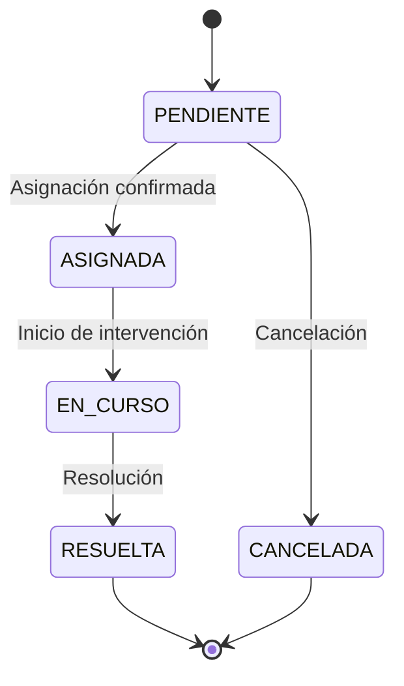
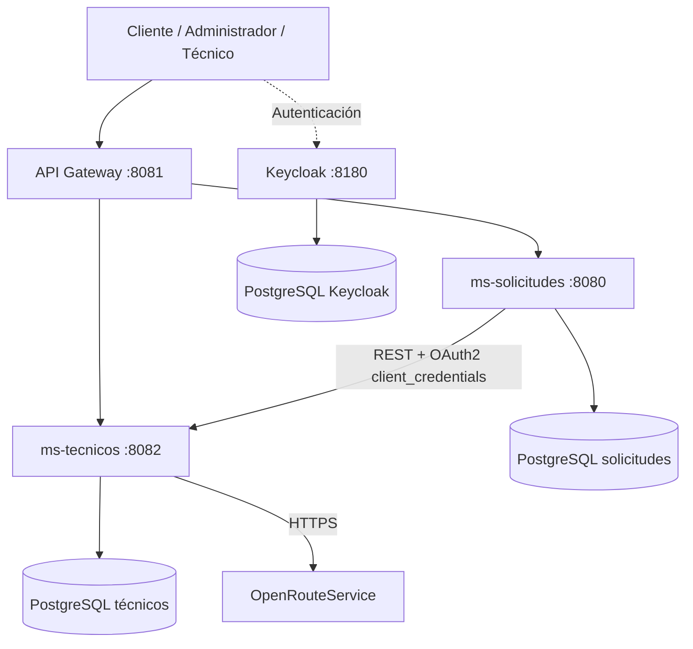

# ServiTec

**Sistema de gestión y asignación de servicios técnicos domiciliarios**  
Trabajo Práctico Integrador 2026 · Backend de Aplicaciones · UTN FRC · Comisión **3K3B** · Equipo **94**

ServiTec es una API REST para empresas que coordinan trabajos técnicos a domicilio (electricidad, plomería, refrigeración, entre otros). Permite administrar técnicos y sus agendas, registrar solicitudes de clientes, buscar candidatos y **asignar manualmente** un técnico con validaciones de especialidad, disponibilidad, reservas existentes y tiempo estimado de traslado.

El sistema cubre el ciclo de vida de una solicitud desde su creación hasta la resolución de la intervención. **No incluye frontend propio**: las operaciones se realizan mediante la API, que puede probarse con Postman.

## Funcionalidades

- **Administración:** alta, consulta, modificación y desactivación de técnicos; gestión de especialidades y disponibilidades.
- **Clientes:** creación y consulta de solicitudes; cancelación mientras permanecen pendientes.
- **Búsqueda de candidatos:** filtrado por técnico activo, especialidad, disponibilidad, ausencia de reservas superpuestas y traslado estimado de **hasta 45 minutos**.
- **Asignación manual asistida:** el administrador selecciona al técnico; el sistema revalida las condiciones y confirma una reserva. Ante un fallo posterior a la reserva, intenta liberarla como compensación.
- **Técnicos:** consulta de trabajos asignados, inicio de intervención y registro de diagnóstico y resolución.
- **Seguridad:** autenticación mediante Keycloak y autorización por roles y pertenencia de los recursos.

**Regla de traslado:** cada técnico parte de su **ubicación base fija**. No se utiliza GPS en tiempo real ni se calculan desplazamientos entre trabajos consecutivos. La estimación se obtiene mediante **OpenRouteService**.

### Estados de una solicitud



## Arquitectura

El backend utiliza dos microservicios de negocio, cada uno con su propia base PostgreSQL, y un API Gateway como punto de entrada.



| Módulo | Responsabilidad |
| --- | --- |
| `api-gateway` | Entrada a la API, enrutamiento y seguridad JWT. |
| `ms-solicitudes` | Solicitudes, asignaciones, estados e intervenciones. |
| `ms-tecnicos` | Técnicos, especialidades, disponibilidades, reservas y evaluación de candidatos. |
| `servitec-common` | Biblioteca Maven compartida para código transversal. No es un contenedor independiente. |
| `keycloak` | Identidades, roles y emisión de tokens. |

**Tecnologías principales:** Java 17, Spring Boot 3.5.7, Spring Cloud Gateway, Spring Security, OAuth2/OpenID Connect, Spring Data JPA/Hibernate, PostgreSQL 16, Keycloak 26.0.8, Maven, Docker y Docker Compose. Se utiliza Springdoc OpenAPI para documentación de los microservicios.

Las referencias entre microservicios se almacenan mediante identificadores lógicos, **sin claves foráneas entre sus bases de datos**.

## Requisitos

- Git.
- Docker Desktop con motor Linux y Docker Compose, o Docker Engine + Compose en Linux.
- Una **API Key válida de OpenRouteService** para las operaciones que calculan traslados.
- Postman para ejecutar la colección incluida.

**No es necesario instalar Java, Maven ni PostgreSQL en el equipo anfitrión** si se utiliza Docker Compose.

## Instalación y ejecución con Docker

### 1. Clonar el repositorio

```bash
git clone https://github.com/MateoSpinacci/ServiTec.git
cd ServiTec
```

### 2. Configurar variables de entorno

Crear un archivo `.env` a partir de `.env.example` en la **raíz del repositorio**:

```powershell
# PowerShell (Windows)
Copy-Item .env.example .env
```

```bash
# Linux / macOS
cp .env.example .env
```

Completar los valores en `.env`:

| Variable | Uso |
| --- | --- |
| `TECNICOS_DB_PASSWORD` | Contraseña de PostgreSQL de técnicos. |
| `SOLICITUDES_DB_PASSWORD` | Contraseña de PostgreSQL de solicitudes. |
| `KEYCLOAK_DB_PASSWORD` | Contraseña de PostgreSQL de Keycloak. |
| `KEYCLOAK_ADMIN_USER` | Usuario administrador de la consola de Keycloak. |
| `KEYCLOAK_ADMIN_PASSWORD` | Contraseña de la consola de Keycloak. |
| `MS_SOLICITUDES_CLIENT_SECRET` | Secreto del cliente confidencial `ms-solicitudes` para autenticación entre servicios. |
| `ORS_API_KEY` | Clave de OpenRouteService para estimar tiempos de viaje. |

> **Importante:** no subir `.env` al repositorio. `.gitignore` ya lo excluye. El archivo `.env.example` contiene marcadores que deben reemplazarse; no utilizar `cambiar_esto` como credencial definitiva. La clave de ORS es necesaria para completar el flujo de asignación.

El proyecto incluye `keycloak/servitec-realm.json`, que se importa al iniciar Keycloak en una instalación nueva. El secreto del cliente interno configurado en Keycloak debe coincidir con `MS_SOLICITUDES_CLIENT_SECRET` del microservicio. **Si ya existía un volumen de Keycloak, modificar el JSON no vuelve a importar automáticamente el realm**: revisar la configuración del cliente en la consola.

### 3. Construir y levantar el sistema

Desde la raíz:

```bash
docker compose up --build -d
```

Esperar a que finalice el arranque y comprobar los contenedores:

```bash
docker compose ps
docker compose logs --tail=80 ms-tecnicos ms-solicitudes api-gateway
```

El despliegue comprende **siete contenedores**: tres aplicaciones Spring Boot, Keycloak y tres instancias PostgreSQL. Las bases de datos disponen de comprobaciones de salud en Compose. El estado `Up` de una aplicación no sustituye una prueba HTTP de su funcionamiento.

### 4. URLs locales

| Servicio | URL |
| --- | --- |
| **API Gateway (entrada pública)** | `http://localhost:8081` |
| Keycloak | `http://localhost:8180` |
| Consola de Keycloak | `http://localhost:8180/admin` |
| `ms-solicitudes` (acceso directo de desarrollo) | `http://localhost:8080` |
| `ms-tecnicos` (acceso directo de desarrollo) | `http://localhost:8082` |
| PostgreSQL solicitudes | `localhost:5434` |
| PostgreSQL técnicos | `localhost:5433` |
| PostgreSQL Keycloak | `localhost:5435` |

La API pública utiliza el prefijo `/api/v1`. Por ejemplo: `http://localhost:8081/api/v1/especialidades`.

Las rutas internas de reservas **no se publican a través del Gateway**; se utilizan en la comunicación autenticada entre servicios.

### 5. Verificar el arranque

```bash
# Debe responder 200 si el realm está disponible
curl -i http://localhost:8180/realms/servitec/.well-known/openid-configuration

# Debe responder 401 sin un token JWT
curl -i http://localhost:8081/api/v1/especialidades
```

Un `401 Unauthorized` en la segunda petición es **esperado**. Para verificar el enrutamiento real y las operaciones de negocio, continuar con un token válido en Postman.

### 6. Detener el sistema

```bash
docker compose down
```

Los datos PostgreSQL se conservan en volúmenes. **No utilizar `docker compose down -v` salvo que se quiera eliminar deliberadamente los datos persistidos**, incluidos usuarios y configuración de Keycloak.

## Autenticación y autorización

Keycloak administra el realm `servitec` y los roles:

| Rol | Acciones principales |
| --- | --- |
| `CLIENTE` | Crear y consultar solicitudes propias; cancelar solicitudes pendientes propias. |
| `ADMIN` | Administrar técnicos, especialidades y disponibilidades; consultar candidatos y asignar técnicos. |
| `TECNICO` | Consultar sus trabajos e iniciar y resolver sus intervenciones asignadas. |
| `SERVICIO_INTERNO` | Autorizar las operaciones internas entre microservicios. |

El repositorio incluye usuarios de demostración en la configuración del realm (por ejemplo, `admin1`, `cliente1` y `tecnico1`). Las credenciales para pruebas deben obtenerse de la configuración de desarrollo del proyecto o definirse en Keycloak; no se publican contraseñas en este README.

El cliente público `servitec-api` permite obtener tokens para las pruebas de usuarios. `ms-solicitudes` utiliza un cliente confidencial con **OAuth2 `client_credentials`** para invocar las operaciones internas de `ms-tecnicos`.

## Probar la API con Postman

Archivos incluidos:

```text
postman/
├── ServiTec.postman_collection.json
└── ServiTec - Local.postman_environment.json
```

1. Importar **ambos archivos** en Postman.
2. Seleccionar el entorno importado.
3. Completar las variables de URL y las credenciales de los usuarios de prueba.
4. Ejecutar las peticiones de autenticación para obtener los tokens de `ADMIN`, `CLIENTE` y `TECNICO`.
5. Ejecutar las operaciones en el orden del flujo de negocio o utilizar la carpeta **`06 - Ejecución automatizada`** con el Collection Runner.

### Variables de Postman

La colección utiliza URLs base **sin** el sufijo `/api/v1`, porque las peticiones ya incorporan rutas como `/tecnicos` y `/solicitudes`.

| Variable | Valor para probar mediante Gateway |
| --- | --- |
| `baseUrlTecnicos` | `http://localhost:8081/api/v1` |
| `baseUrlSolicitudes` | `http://localhost:8081/api/v1` |
| `keycloakUrl` | `http://localhost:8180` |
| `usernameAdmin`, `passwordAdmin` | Credenciales del usuario de prueba ADMIN. |
| `usernameCliente`, `passwordCliente` | Credenciales del usuario de prueba CLIENTE. |
| `usernameTecnico`, `passwordTecnico` | Credenciales del usuario de prueba TECNICO. |

La colección almacena o reutiliza variables como `tokenAdmin`, `tokenCliente`, `tokenTecnico`, `especialidadId`, `tecnicoId` y `solicitudId`. **El entorno exportado puede contener valores vacíos**, por lo que es necesario configurarlos antes de ejecutar las peticiones.

> Las URLs anteriores son para **operaciones públicas**. Los endpoints internos de reservas no se enrutan por el Gateway y deben probarse exclusivamente en el contexto autorizado correspondiente.

### Orden recomendado de la demostración

1. Obtener tokens de los tres roles desde Keycloak.
2. Registrar o consultar una especialidad.
3. Registrar un técnico con especialidad y ubicación base; crear su disponibilidad.
4. Crear una solicitud como `CLIENTE` → estado `PENDIENTE`.
5. Buscar técnicos candidatos como `ADMIN`, aplicando especialidad, agenda, reservas y traslado máximo de 45 minutos.
6. Asignar el técnico seleccionado → estado `ASIGNADA` y reserva confirmada.
7. Consultar los trabajos del técnico asignado.
8. Iniciar la intervención → estado `EN_CURSO`.
9. Registrar diagnóstico y resolución → estado `RESUELTA`.
10. Consultar la solicitud y verificar el estado final.

Para que la demostración sea reproducible, utilizar **horarios futuros** y disponibilidades que cubran la duración solicitada, sin reservas superpuestas. Las coordenadas de origen y destino deben permitir un traslado viable según ORS.

La colección contiene además casos negativos de autenticación, permisos, datos inválidos, duplicados, superposición de disponibilidades y transiciones de estado incompatibles. **No todos los escenarios comprometidos están necesariamente automatizados en el runner**; complementar con las peticiones manuales pertinentes cuando corresponda.

## Endpoints principales

Todos los endpoints públicos de la tabla se consumen mediante `http://localhost:8081` y requieren los permisos correspondientes.

| Método | Ruta | Función |
| --- | --- | --- |
| `POST` / `GET` | `/api/v1/especialidades` | Registrar / consultar especialidades. |
| `POST` / `GET` | `/api/v1/tecnicos` | Registrar / listar técnicos. |
| `GET` / `PATCH` | `/api/v1/tecnicos/{id}` | Consultar / actualizar técnico. |
| `PATCH` | `/api/v1/tecnicos/{id}/desactivacion` | Desactivar técnico. |
| `POST` / `GET` | `/api/v1/tecnicos/{id}/disponibilidades` | Registrar / consultar disponibilidad. |
| `PATCH` | `/api/v1/tecnicos/{id}/disponibilidades/{disponibilidadId}` | Modificar disponibilidad. |
| `POST` | `/api/v1/tecnicos/candidatos` | Buscar técnicos candidatos. |
| `POST` / `GET` | `/api/v1/solicitudes` | Crear / consultar solicitudes. |
| `GET` | `/api/v1/solicitudes/{id}` | Consultar solicitud por ID. |
| `PATCH` | `/api/v1/solicitudes/{id}/cancelacion` | Cancelar solicitud pendiente. |
| `POST` | `/api/v1/solicitudes/{id}/asignaciones` | Asignar técnico y coordinar reserva. |
| `GET` | `/api/v1/trabajos` | Consultar trabajos del técnico. |
| `PATCH` | `/api/v1/solicitudes/{id}/inicio` | Iniciar intervención. |
| `PATCH` | `/api/v1/solicitudes/{id}/resolucion` | Resolver intervención. |

**Operaciones internas:** `POST /api/v1/reservas` y `POST /api/v1/reservas/{id}/liberacion` en `ms-tecnicos`. No se exponen como rutas públicas del Gateway.

Los microservicios incorporan Springdoc OpenAPI/Swagger para consultar sus contratos durante el desarrollo. Sus rutas de documentación se consultan directamente en cada servicio, ya que el Gateway no define rutas públicas para Swagger.

## Pruebas automatizadas de Java

El proyecto incluye pruebas unitarias de servicios con JUnit y Mockito, además de clases de prueba de contexto de Spring Boot.

Para ejecutar las pruebas unitarias sin requerir el arranque completo de la infraestructura, desde la raíz del proyecto, con Java 17 y Maven disponibles:

```bash
mvn clean test -Dtest='!*ApplicationTests' -Dsurefire.failIfNoSpecifiedTests=false
```

En **PowerShell**:

```powershell
mvn clean test "-Dtest=!*ApplicationTests" "-Dsurefire.failIfNoSpecifiedTests=false"
```

Este comando **excluye los tests de contexto `*ApplicationTests`**. La validación del despliegue completo se realiza por separado con Docker Compose y las pruebas HTTP de Postman. Las imágenes Docker se construyen con `-DskipTests`; construirlas correctamente no implica haber ejecutado las pruebas de Java.

## Estructura del repositorio

```text
ServiTec/
├── api-gateway/           # Enrutamiento y seguridad de entrada
├── ms-solicitudes/        # Solicitudes, asignaciones e intervenciones
├── ms-tecnicos/           # Técnicos, especialidades, agendas y reservas
├── servitec-common/      # Biblioteca Maven compartida
├── keycloak/
│   └── servitec-realm.json
├── postman/
│   ├── ServiTec.postman_collection.json
│   └── ServiTec - Local.postman_environment.json
├── docker-compose.yaml
├── .env.example
└── pom.xml                # Proyecto padre Maven (reactor)
```

## Alcance del MVP

El alcance implementado se centra en **asignación manual asistida** y una única intervención por solicitud. Quedan fuera: pagos, facturación, notificaciones automáticas, seguimiento GPS, optimización de recorridos, asignación automática, reasignaciones, inventario/repuestos y cancelación de solicitudes ya asignadas o en curso.

## Equipo

**UTN Facultad Regional Córdoba — Ingeniería en Sistemas de Información**  
**Backend de Aplicaciones · TPI 2026 · Comisión 3K3B · Equipo 94**

- Mateo Spinacci
- Santino Brond Iglesias
- Facundo Díaz
- Lautaro Alexis Vijarra

**Repositorio:** https://github.com/MateoSpinacci/ServiTec
